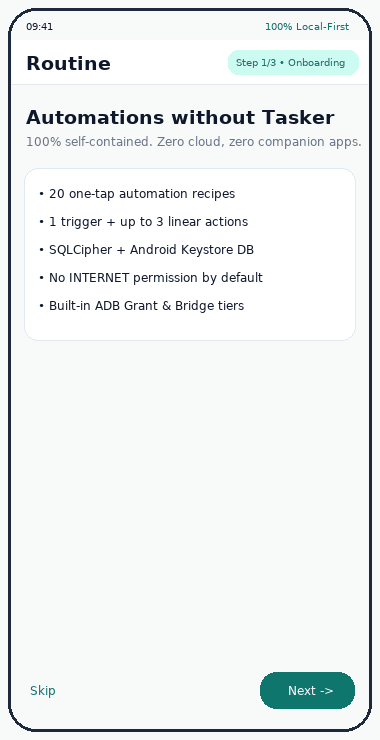

# Routine

[](https://github.com/Ans-to/Routine/actions/workflows/ci.yml)
[](https://github.com/Ans-to/Routine/releases)
[](LICENSE)
[-3ddc84.svg)](app/build.gradle.kts)
[](docs/permissions.md)

> **Automations for people who don't want to learn Tasker.**

**Routine** is a local-first, **100% self-contained** Android automation app built with Kotlin, Coroutines/`Flow`, Hilt, SQLCipher Room, and Material 3 Jetpack Compose. Activate any of **20 built-in one-tap templates** or create a clean linear rule (**1 trigger + up to 3 ordered actions**) with live side-effect-free dry-run previews — **with zero external companion apps (no Shizuku, no Tasker, no Termux, no LADB), zero cloud sync, zero analytics, and zero `INTERNET` permission in the default build.**

<p align="center">
  
</p>

---

## Why Routine?

- **Zero External App Dependencies**: Everything lives inside Routine. Standard automations work immediately; privileged toggles use Routine's own **One-Time ADB Grant** (with built-in QR code & clipboard helper) or **Built-in Wireless Debugging Bridge** (pure-Kotlin SPAKE25519 + TLS 1.3 pairing & internal `app_process` Binder shell server).
- **Strictly Linear Mental Model**: No node graphs, flowcharts, variables, or scripting languages. Pick **1 trigger** and **1 to 3 reorderable actions**, tap **Test Rule (Dry Run)** to preview every step without side effects, and save.
- **Privacy & Security by Design**:
  - **No `INTERNET` permission** in the default `offline` APK (verified automatically in CI).
  - **Encrypted at rest**: Rules and logs are stored in Room encrypted via **SQLCipher 4.9 + Android Keystore AES-256-GCM**.
  - **1,000-entry auto-rotating redacted logs**: SMS bodies, phone numbers, tokens, passwords, and shell setting values are scrubbed by `LogRedactor` before touching disk.
  - **5-failure circuit breaker**: Automatically pauses a rule after 5 consecutive failures and notifies you why.
  - **Local SAF JSON backup/restore**: Schema-versioned JSON import/export via Android's system document picker — zero broad storage permissions.

---

## Three Self-Contained Capability Tiers

| Tier | How It Works | Survives Reboot? | Companion Apps Needed |
| :--- | :--- | :--- | :--- |
| **1. Standard Tier** *(Default)* | Android runtime & special permissions (`AlarmManager`, `BroadcastReceiver`, `WorkManager`, `NotificationManager`, `CallScreeningService`, optional deterministic `AccessibilityService`) with graceful fallbacks when declined | **Yes** | **None** |
| **2. One-Time ADB Grant** *(Option B)* | Run `adb shell pm grant app.routine android.permission.WRITE_SECURE_SETTINGS` once (or scan Routine's built-in QR code). Writes `Settings.Secure` / `Settings.Global` directly via `ContentResolver` with zero daemon | **Yes** | **None** |
| **3. Wireless ADB Bridge** *(Option A, `wirelessAdb` flavor)* | Pure-Kotlin on-device mDNS discovery + notification-shade 6-digit pairing + TLS 1.3 SPAKE25519 + internal `app_process` Binder shell server from Routine's own APK; self-grants `WRITE_SECURE_SETTINGS` for post-reboot auto-reconnection | **Yes** *(auto-reconnects on Wi-Fi)* | **None** |

---

## 20 Built-In One-Tap Templates

Adding a new template requires **zero changes** to `:core:engine` or Compose UI screens (see `scripts/new_template.py`).

| # | Template | Trigger | Action(s) | Capability Badge |
| :-: | :--- | :--- | :--- | :--- |
| 1 | **Turn off Wi-Fi at bedtime** | `TIME` (23:00) | `WIFI_TOGGLE` (`off`) | Privileged |
| 2 | **Enable DND during meetings** | `CALENDAR_OR_MANUAL` (`CALENDAR_BUSY`) | `DO_NOT_DISTURB` (`on`) | Standard + DND |
| 3 | **Auto-reply SMS when driving** | `BLUETOOTH_CONNECTED` (`CAR`) | `SMS_AUTO_REPLY` | Standard + BT/SMS |
| 4 | **Mobile data limit alert** | `PERIODIC_CHECK` (`MOBILE_DATA_MB >= 5000`) | `NOTIFY` | Standard + Usage |
| 5 | **Battery saver below 20%** | `BATTERY_LEVEL` (`BELOW 20%`) | `BATTERY_SAVER` | Standard |
| 6 | **Bedtime mode** | `TIME` (22:30) | `DO_NOT_DISTURB` + `BRIGHTNESS` (`15%`) | Standard + DND/Display |
| 7 | **Unplug charger at 80%** | `BATTERY_LEVEL` (`ABOVE 80%`, charging) | `NOTIFY` | Standard |
| 8 | **Open app on work Wi-Fi** | `WIFI_SSID` (`CONNECTED`) | `OPEN_APP` | Standard + Wi-Fi/Location |
| 9 | **Silence phone at cinema/mosque** | `LOCATION_GEOFENCE` (`ENTER`) | `RINGER_MODE` (`SILENT`) | Standard + Geofence |
| 10 | **Morning briefing on charger** | `TIME` (07:30, charging) | `OPEN_APP` (`NEWS`) + `NOTIFY` | Standard |
| 11 | **Lock rotation for video apps** | `APP_OPENED` (VLC / YouTube) | `ROTATION_LOCK` (`locked`) | Optional Accessibility |
| 12 | **Night Light at sunset** | `TIME` (19:00) | `SECURE_SETTING` (`night_display_activated=1`) | Privileged (Option B/A) |
| 13 | **Auto-disable hotspot after 30m** | `HOTSPOT_DURATION` (`30m`) | `HOTSPOT_TOGGLE` (`off`) | Privileged |
| 14 | **Low free storage alert** | `PERIODIC_CHECK` (`FREE_STORAGE_PERCENT <= 10%`) | `NOTIFY` | Standard |
| 15 | **Launch music on headphones** | `BLUETOOTH_CONNECTED` (`AUDIO`) | `OPEN_APP` (`MUSIC`) | Standard + BT |
| 16 | **Turn off Wi-Fi leaving home** | `WIFI_SSID` (`DISCONNECTED`) | `WIFI_TOGGLE` (`off`) | Privileged |
| 17 | **Shorten screen timeout per app** | `APP_OPENED` | `SECURE_SETTING` (`screen_off_timeout=15000`) | Privileged + Accessibility |
| 18 | **Weekly photo backup reminder** | `TIME` (`SUN` 18:00) | `NOTIFY` | Standard |
| 19 | **Silence unknown callers** | `CALL_RECEIVED` (`unknownOnly=true`) | `SILENCE_UNKNOWN_CALLER` | Standard + CallScreening |
| 20 | **Morning summary on alarm dismissed** | `ALARM_DISMISSED` | `NOTIFY` | Standard |

---

## Permission Summary

Routine **never** requests permissions silently — every permission prompt or Settings redirect is preceded by an explanatory bottom sheet detailing why it is needed and how Routine falls back if declined.

| Permission | Scope | Purpose | Graceful Fallback |
| :--- | :--- | :--- | :--- |
| `POST_NOTIFICATIONS` | Standard | Rule notifications & safety alerts | Rules still execute; notification steps show setup chip |
| `SCHEDULE_EXACT_ALARM` | Standard | Exact-minute `TIME` & hotspot triggers | Falls back to `setAndAllowWhileIdle` |
| `REQUEST_IGNORE_BATTERY_OPTIMIZATIONS` | Standard | Reliable background execution under OEM Doze | Optional; WorkManager continues under standard Doze |
| `ACCESS_NOTIFICATION_POLICY` | Standard | Do Not Disturb & Silent ringer mode | Falls back to Vibrate mode or DND Settings intent |
| `WRITE_SETTINGS` | Standard | Brightness & auto-rotation lock | Opens Display Settings panel |
| `ACCESS_WIFI_STATE` / `ACCESS_*_LOCATION` | Standard | Wi-Fi SSID matching & venue geofences | Affected templates show Amber `Setup` badge |
| `BLUETOOTH_CONNECT` | Standard | Car & headphone Bluetooth triggers | Affected templates show Amber `Setup` badge |
| `READ_CALENDAR` | Standard | Busy-meeting detection | Manual trigger mode works without Calendar |
| `SEND_SMS` | Standard | Optional direct SMS auto-reply | Default `INTENT` mode pre-fills SMS app without `SEND_SMS` |
| `PACKAGE_USAGE_STATS` | Standard | Monthly mobile data check | Falls back to `TrafficStats` counters |
| `READ_CONTACTS` / `ROLE_CALL_SCREENING` | Standard | Silence non-contact callers | Inactive until user opts in |
| `BIND_ACCESSIBILITY_SERVICE` | Optional | Foreground package name detection (`canRetrieveWindowContent=false`) | Only used for templates #11 & #17; zero UI scraping/tapping |
| `WRITE_SECURE_SETTINGS` | Privileged | Direct secure/global setting toggles | Grey `Privileged` badge with setup wizard |
| `INTERNET` | **`wirelessAdb` flavor only** | Loopback `127.0.0.1` ADB pairing socket | **Completely absent from default `offline` APK** |

---

## Building, Testing & Installing

### Download Prebuilt Signed APK (`< 15 MB`)

Download `Routine-v0.1.0-alpha-offline.apk` (zero `INTERNET` permission, F-Droid ready) or `Routine-v0.1.0-alpha-wirelessAdb.apk` (with built-in on-device Wireless Debugging pairing) plus `SHA256SUMS.txt` from [**GitHub Releases**](https://github.com/Ans-to/Routine/releases).

### Build from Source

```bash
git clone https://github.com/Ans-to/Routine.git
cd Routine

# Assemble default zero-INTERNET APKs
./gradlew assembleOfflineDebug assembleOfflineRelease

# Run full lint, static analysis, unit/Robolectric/Compose tests & JaCoCo coverage gates
./gradlew ktlintCheck detekt lintOfflineDebug \
  testDebugUnitTest :app:testOfflineDebugUnitTest \
  :core:model:test :core:permissions:test :core:engine:test \
  :privilege:api:test :core:data:verifyCoreDataJacocoCoverage
```

---

## Documentation

- [**Architecture & 15-Module Graph**](docs/architecture.md)
- [**Self-Contained Privileged Engine (Option A & Option B)**](docs/privilege-engine.md)
- [**Permissions & Graceful Fallbacks**](docs/permissions.md)
- [**Contributor Guide & Template Generator**](docs/contributing.md)
- [**F-Droid Build Metadata**](metadata/app.routine.yml)

## License

Copyright (C) 2026 Routine Contributors.

Routine is free software: you can redistribute it and/or modify it under the terms of the [**GNU General Public License v3.0**](LICENSE) (`GPL-3.0-only`).
